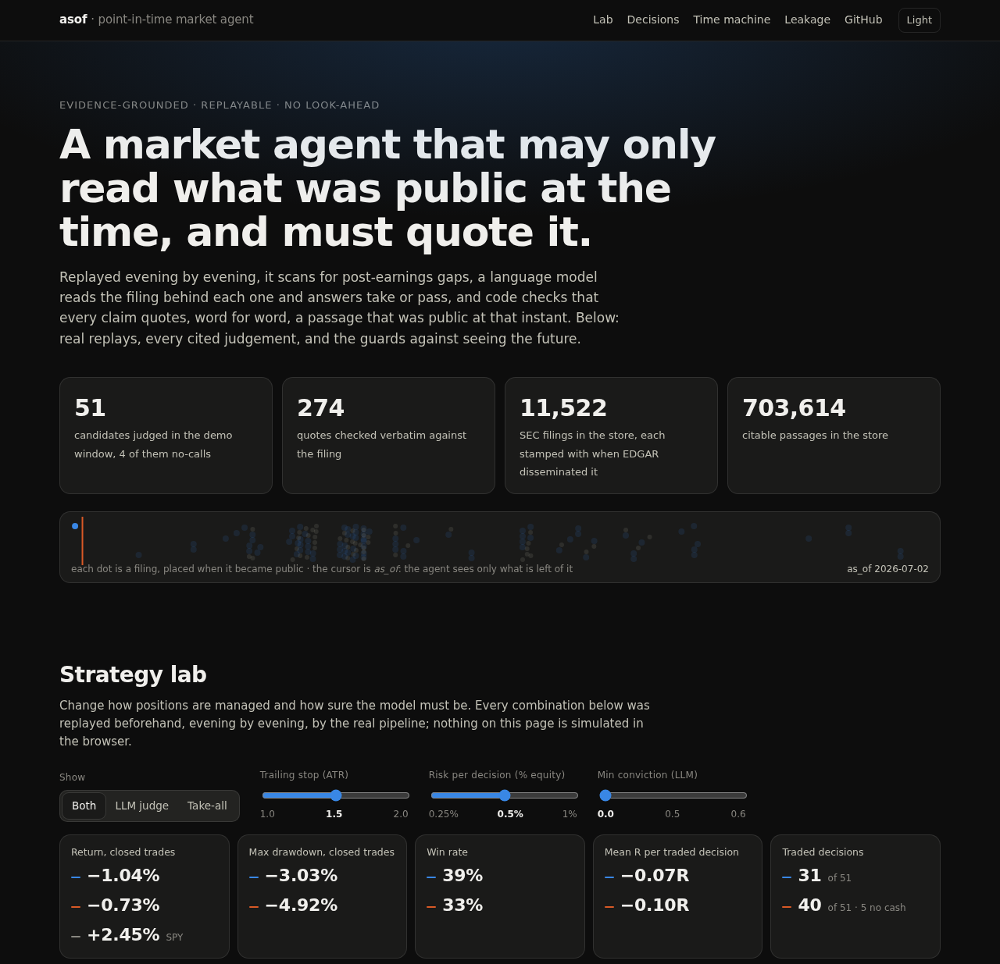
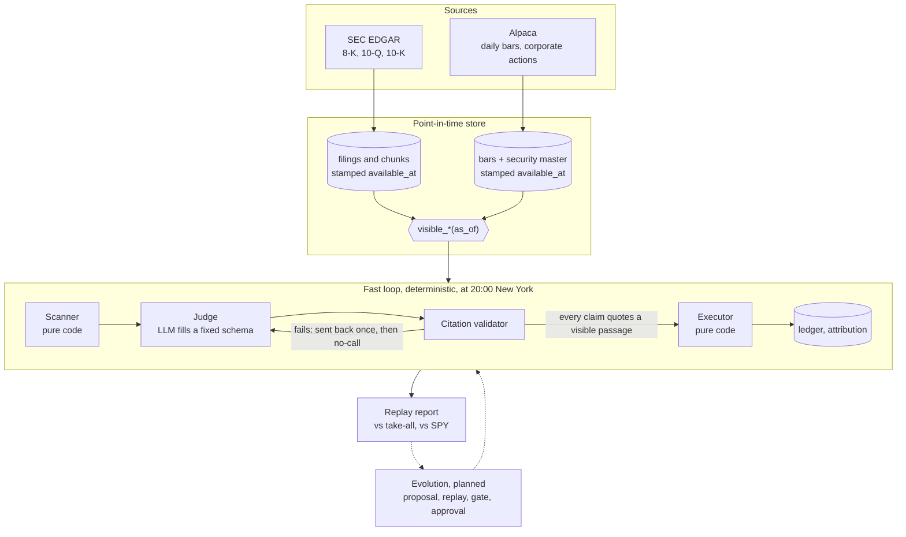

# asof

A point-in-time correct market research agent: it may only read what was public at the
time, and every conclusion must quote it.

**[Live demo](https://zhenglin17.github.io/asof/)**: replays you can tune, every cited
judgement, and the guards against seeing the future.

[](https://zhenglin17.github.io/asof/)

Replayed evening by evening, it scans for post-earnings gaps, a language model reads the
filing behind each one and answers take or pass, and code checks that every claim quotes,
word for word, a passage that was public at that instant. A simulated executor trades the
takes, a ledger records every leg, and a report compares the result with a judge that takes
everything and with SPY.

The core invariant: **every read of data is bound to an `as_of` instant and may only see what
was available then.** Filings are filtered on when EDGAR made them public (`available_at`),
not on the period they describe; revisions are appended, never overwritten. Any violation is
look-ahead leakage and is treated as a bug.

The full manual (every command, what each stage stores, the source layout) is
[docs/commands.md](docs/commands.md).

## How it works



- **Store.** About 300 watchlist instruments, daily bars for every listed US symbol since 2020
  (delisted ones included), and 11,522 filings of 218 companies in 703,614 citable chunks. A
  security master maps each symbol-day to a permanent security across renames and ticker
  reuse. Every row carries the instant it became knowable; all reads go through
  `visible_*(session, as_of)`. [Details](docs/commands.md#commands-at-a-glance)
- **Scanner.** `earnings_gap`: the first session after an earnings release gapped up at least
  4% on at least twice its 20-day volume. [Details](docs/commands.md#replay)
- **Judge.** Either take-all (the baseline) or an LLM that sees the reaction-day numbers and
  the triggering filing as public that evening, and answers take or pass with a conviction
  and one to eight claims, each quoting a chunk. Code, not the model, decides what happens
  next. Answers are cached by request, so a replay runs offline and repeats exactly (the cache
  holds the filings and is not part of the repository).
  [Details](docs/commands.md#llm-judge)
- **Citation validator.** A claim must quote, word for word, a chunk of the right company
  that was public at that instant. [Details](docs/commands.md#evidence)
- **Executor.** Next-open entry, ATR zone stops with a trailing key and one re-entry, sizing
  from a fixed risk budget with position and exposure caps. Each closed leg is a ledger row.
- **Evolution** (in progress). Every parameter set a replay runs under is registered, so the
  number of attempts is on record for the significance gate a change will have to pass. The
  evaluation protocol is pre-registered in [`configs/evaluation.yaml`](configs/evaluation.yaml):
  development dates, a sealed one-year holdout that code refuses to replay unless a strategy
  opens it (once), and the gate's settings. Results are compared with SPY and QQQ (dividends
  reinvested) and with a mechanical basket: each month, the 10 largest stocks by recent
  dollar volume, equal weight. [Details](docs/commands.md#benchmarks) Each trade is also
  tested against random entries: the same dates and exits with a security drawn from what the
  scanner could have bought that evening without its signal, corrected for every variant
  tried. [Details](docs/commands.md#random-entry-null) Every replay records its account marked
  to market at each close, set against the same benchmarks on return, drawdown and Sharpe.
  [Details](docs/commands.md#strategy-versus-benchmarks) The gate report puts these side by
  side over development dates only: the random-entry test, walk-forward (does a pick made on
  two years beat random entries on the next six months), the edge without the best three legs
  and with an extra cost, and the benchmarks. While strategies are explored it measures and
  does not score; a pass mark is set when a strategy is about to be run.
  [Details](docs/commands.md#gate-report)

## Results so far

One replay of the LLM judge, 2026-07-01 to 2026-10-16 (where the data ended), after the
model's training cutoff (2026-06-30), default settings, next to take-all over the same
candidates. No significance test has been run, and none of the differences below is
distinguishable from noise.

|                         | LLM judge | Take-all | SPY (price only) |
|-------------------------|----------:|---------:|-----------------:|
| Candidates              | 51: 32 take, 15 pass, 4 no-call | 51 | |
| Traded decisions        | 31        | 40       |                  |
| Winners                 | 12 of 31  | 13 of 40 |                  |
| Return, closed trades   | -1.04%    | -0.73%   | +2.45%           |
| Max drawdown, closed    | 3.0%      | 4.9%     |                  |
| Mean R per traded decision | -0.07  | -0.10    |                  |

- The LLM's lower drawdown mostly reflects fewer trades and less money at risk, not better
  selection; the win rates differ by one winning trade, and the mean R gap comes from four
  trades take-all had no capital left for.
- Take-all did not trade every candidate either: the exposure caps skipped some, and a pass
  frees room for another trade, so the comparison mixes judgement with capacity.
- The 11 passes that take-all traded earned it +0.23R on average, but -0.24R without the
  single best one (NOW, +4.95R).
- On the demo page's grid of 36 settings, LLM minus take-all changes sign with the stop and
  risk settings. The minimum-conviction 0.6 cells look best, but they are the same 5 trades.

**51 candidates in one market regime cannot tell whether the judge helps**; what this shows is
the pipeline running end to end with every decision traceable to the passage it rests on.

Take-all over 2023-01-03 to 2026-10-16: 643 candidates, 547 traded, and the ten best trades
made 77% of the profit. Marked to market at every close:

|                       | Take-all | SPY     | QQQ     | Top-10 basket |
|-----------------------|---------:|--------:|--------:|--------------:|
| Total return          | +63.2%   | +107.7% | +169.6% | +417.7%       |
| Max drawdown          | 11.0%    | 18.8%   | 22.8%   | 29.5%         |
| Sharpe (daily, rf 0)  | 1.08     | 1.38    | 1.41    | 1.59          |

Benchmarks reinvest dividends. The strategy had 40% of its equity invested on average, so its
smaller drawdown is the cash, not an edge; a Sharpe ratio does not change with leverage, and on
it the strategy trails too, though with under four years of daily returns its standard error
is about 0.5 and the gap to SPY is within it. By period the Sharpe ratio was 1.50 on development
dates (SPY 1.35), 0.37 on the holdout's dates (SPY 1.68) and -0.07 after the model's cutoff
(SPY 0.80). This strategy was replayed over the holdout before the protocol existed, so none of
this is out of sample, and the watchlist was picked with hindsight. Against random
entries from the same candidate pool on the same days, its 632 closed legs averaged +1.73%
where random picks averaged +1.54%: an edge of +0.19% a leg, p = 0.33. Most of the per-trade
return came from the market and the watchlist, not from the gap. On development dates (where
filings start in 2023) the gate report shows +0.69% a leg over random entries, p = 0.11: no
evidence of an edge, from 383 legs that could only detect one above +1.9%. All of it comes
from three trades (QBTS, SMCI, DUOL); without them it is 0.00%. This strategy was replayed over
these dates before the protocol existed, so none of it is clean evidence.

The grid ran on throwaway copies of the database, so it adds nothing to the recorded attempt
count. It is still a search to anyone who picks its best cell, and is shown as such.

## Leakage guards and the tests behind them

| Way to see the future | Guard | Tests |
|---|---|---|
| Reading a filing before it was public | Filter on `available_at`; revisions are new rows | `tests/store/test_queries.py`, `test_documents.py` |
| Using today's bar during today | A daily bar is visible only after the post-market close | `tests/store/test_market.py`, `tests/replay/test_replay.py` |
| Knowing today what a ticker meant then | Security master as known at each instant; a truncation test rebuilds it from only the inputs knowable then and compares | `tests/ingest/test_master_truncation.py`, `test_truncation_gate.py` |
| Future statistics in search | Ranking uses term statistics of the visible documents only | `tests/evidence/test_retrieve.py`, `tests/store/test_chunk_search.py` |
| Citing a passage that was not public yet | The validator checks the instant; the prompt holds only visible chunks | `tests/judge/test_llm.py`, `tests/judge/test_window.py` |
| A model that already knows the outcome | Results split at the training cutoff; the prompt names the ticker, not today's company name | `tests/replay/test_compare.py`, `tests/judge/test_llm.py` |
| Outcomes visible before they happened | A trade is visible from its exit-day close, an outcome after its re-entry window | `tests/attribute/test_trades.py`, `tests/replay/test_replay.py` |
| A result that depends on later days | Replaying to day N gives the same decisions as replaying further | `tests/replay/test_replay.py` |
| Trying settings until one works | Every parameter set a research replay runs under is registered and counted | `tests/strategy/test_config.py`, `tests/replay/test_report.py` |
| Peeking at the test period | Replays and judge runs that touch the sealed holdout are refused; a strategy may open it once, and the opening is recorded | `tests/evolve/test_holdout.py`, `tests/replay/test_replay_holdout.py` |

On the real store, `asof market audit` runs 34 data checks with reviewed exceptions, and
hand-checked reference histories (renames, ticker reuse, splits) are asserted as tests.

## Known limitations

- **One short window.** The LLM judge has been replayed over 51 candidates in about four
  months; no significance test has been run.
- **Hindsight universe.** The watchlist was picked today, so companies that disappeared are
  under-represented.
- **Daily bars, simple fills.** Within a day the worst order of high and low is assumed;
  fills pay a flat 5 bps of slippage and no commission.
- **Closed trades in the replay report.** Its return and drawdown move when a trade closes and
  its SPY is price only; the comparison above marks open positions daily against
  total-return benchmarks.
- **No income for the strategy.** Idle cash earns no interest and dividends on held stocks are
  not credited; both count against it.
- **Vendor history.** A few identity facts the data vendor rewrote after the fact cannot be
  dated; they are listed in a baseline that may only shrink.
- **One model, one prompt.** Answers are cached; another model or prompt may decide
  differently. A training cutoff hides outcomes, not what the model knew about each company
  before it.
- **Long only, gap-ups only.** Never tested in a falling or very volatile market.
- **Not built yet:** minute bars, macro data, the evolution loop (proposals and approval).

## Quickstart

Requires [uv](https://docs.astral.sh/uv/); Python 3.12 is installed automatically.

```bash
git clone https://github.com/Zhenglin17/asof && cd asof
uv sync
uv run pytest                          # cases that need the real data store skip without it
python3 -m http.server -d web 8000      # the demo page, from the committed data
```

Building the store yourself needs free Alpaca keys and an SEC contact string, and takes hours:

```bash
export ASOF_DATA_DIR=~/asof-data      # default /data/asof
export ALPACA_API_KEY=... ALPACA_SECRET_KEY=... ASOF_SEC_USER_AGENT="name you@example.com"
uv run asof db init && uv run asof entities sync --download
uv run asof market universe && uv run asof market backfill && uv run asof market import-bars
uv run asof market actions && uv run asof market identity && uv run asof market instruments
uv run asof market audit
uv run asof docs sync && uv run asof docs audit && uv run asof evidence index
uv run asof replay run --strategy earnings_gap --start 2023-01-03 --end 2026-10-21
uv run asof replay report --run 1
```

The full pipeline, in order, is in [Commands at a glance](docs/commands.md#commands-at-a-glance).

## Status

- [x] Point-in-time store: bars, security master, filings and chunks, all read through `as_of`
- [x] Data audit and truncation test over the real store
- [x] Evidence search and citation validator
- [x] Fast loop: scanner, take-all and LLM judges, executor, ledger, attribution, replay report
- [x] Demo page on GitHub Pages
- [ ] Minute bars, XBRL facts, FRED
- [x] Gate report: random entries, walk-forward, thin edge, benchmarks, side by side
- [x] First feature: B-Xtrender on split-adjusted daily, weekly and monthly bars, matched against the chart
- [ ] Strategy evolution: proposals, approval

Feature by feature: [Status in detail](docs/commands.md#status-in-detail).

## License

[MIT](LICENSE)
