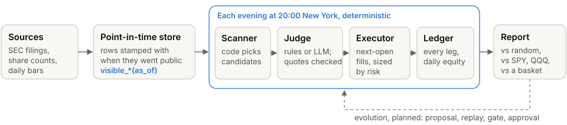

# asof

A point-in-time correct market research rig: every read of data is bound to an `as_of` instant
and may only see what was public then, and every claim a language model makes must quote a
passage that was public at that instant.

**[Live demo](https://zhenglin17.github.io/asof/)**: what the tests found, every cited
judgement, and the guards against seeing the future.

## How it works



- **Store.** Daily bars for every listed US symbol since 2020 (delisted ones included), a
  security master that maps each symbol-day to a permanent security across renames and ticker
  reuse, SEC share counts, and 11,522 filings in 703,614 citable chunks. Every row carries the
  instant it became knowable; filings are filtered on when EDGAR made them public, not on the
  period they describe.
- **Fast loop.** Scanner and executor are plain code; a judge is either rules or an LLM that
  fills a fixed schema, and code checks that each of its claims quotes a visible chunk word for
  word. Replays run evening by evening and repeat exactly.
- **Report and gate.** Each replay is set against random entries from the same pool on the same
  nights, against SPY and QQQ with dividends and a mechanical top-10 basket; every parameter set a
  replay runs under is registered, and a sealed holdout year may be opened once per strategy.

Commands, stages and the source layout: [docs/commands.md](docs/commands.md).

## Results so far

| What was tested | Window | Result | Baseline |
|---|---|---|---|
| B-Xtrender S1 and S3, liquid US stocks | 2020-01 .. 2025-06 | −4.5%, −10.1% | SPY +107% |
| B-Xtrender S2 (needs three years of monthly bars) | 2023-01 .. 2025-06 | −5.3% | SPY +66% |
| B-Xtrender entries alone, held 7 to 60 sessions | 2020-01 .. 2025-06 | no better than random stocks from the same pool | |
| Timing rule, top 20 by market cap as known each January | 2020-02 .. 2025-06 | +117% | held +118%, SPY +108% |
| The same top 20 without the seven big tech stocks | 2020-02 .. 2025-06 | +37% | held +56% |
| The seven (in sample: the rule was shaped here) | 2020-02 .. 2025-06 | +436% | held +433% |
| LLM judge on earnings gaps | 2026-07 .. 2026-10 | 51 candidates, no detectable difference | take-all |

So far nothing tested beats its own baseline. The B-Xtrender replays were about 63% invested and
book no dividends, against SPY with dividends; they ran before a fix that restored Facebook to
the stock universe. "Held" is the same list held throughout and re-weighted on the days the
timing rule trades, so the only difference is when the rule is in or out. The timing rule shown
is the one of its eight frozen variants with the highest return; none of them beats holding on
the top 20 or without the seven. Its one benefit is a smaller
fall in 2022, the only slow bear in the sample and labelled after the fact: 21% against 29% on the
top 20, and 17% against 22% from 2022-04-18, once every name could be traded (that measures only
the second half of the decline). In the fast falls of 2020, 2024-08 and 2025 it fell 29%, 11% and
16% against holding's 30%, 9% and 14%.

No B-Xtrender or timing-rule figure uses a date after 2025-06, and none of these strategies has
been run on the sealed holdout year (2025-07 .. 2026-06). But the timing rule was explored on
2025-07 .. 12 before it was frozen, and take-all on earnings gaps was replayed over the holdout
before the protocol existed. Full numbers and caveats: [docs/results.md](docs/results.md).

## Leakage guards

| Way to see the future | Guard |
|---|---|
| Reading a filing before it was public | Filter on `available_at`; revisions are new rows |
| Knowing today what a ticker meant then | Security master as known at each instant, checked by a truncation test |
| Classing an old listing by today's fund table | A ticker is a fund only for a listing with no CIK or the fund's own (FB was Facebook until 2022) |
| Citing a passage that was not public yet | The validator checks the instant; the prompt holds only visible chunks |
| Trying settings until one works | Every parameter set a replay runs under is registered and counted |

All 17 guards, each with the tests that hold it: [docs/leakage.md](docs/leakage.md). On the real
store, `asof market audit` runs 40 data checks with reviewed exceptions.

## Known limitations

- **Hindsight.** The timing rule was shaped on the seven big tech stocks, partly on dates inside
  the holdout year; the earnings-gap watchlist was picked today.
- **Short samples.** One slow bear market; 51 LLM-judged candidates.
- **Exploratory scripts.** The timing-rule runs are outside the replay pipeline and not in this
  repository; their curves are committed as data.
- **Daily bars, simple fills.** Flat 5 bps slippage, no commission; replays book no dividends.
- **Rough market caps.** SEC share counts; ADRs and companies without an all-class count are
  left out of the top-20 lists.
- **Not built yet:** minute bars, macro data, the evolution loop (proposals and approval).

## Quickstart

Requires [uv](https://docs.astral.sh/uv/); Python 3.12 is installed automatically.

```bash
git clone https://github.com/Zhenglin17/asof && cd asof
uv sync
uv run pytest                          # cases that need the real data store skip without it
python3 -m http.server -d web 8000      # the demo page, from the committed data
```

Building the store needs free Alpaca keys, an SEC contact string and several hours:
[Commands at a glance](docs/commands.md#commands-at-a-glance).

## Status

- [x] Point-in-time store, data audit and truncation test over the real store
- [x] Evidence search and citation validator; LLM and take-all judges
- [x] Replays with daily equity, gate report (random entries, walk-forward, benchmarks)
- [x] B-Xtrender and THT features, scans and execution rules, measured on development dates
- [x] Point-in-time market caps from SEC share counts
- [ ] Minute bars, macro data, strategy evolution (proposals, approval)

Feature by feature: [Status in detail](docs/commands.md#status-in-detail).

## License

[MIT](LICENSE)
